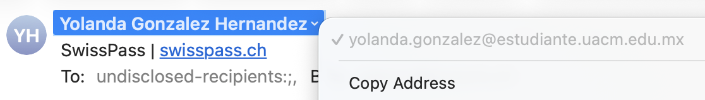

Partie 3 · Outils du quotidien

# Emails & phishing

_L'email reste la porte d'entrée n°1 des arnaques (phishing / hameçonnage)._

## Les 3 signaux à vérifier

### 1. L'adresse source

- Domaines qui imitent (typosquatting): ex: `goggle.com` à la place de `google.com`
- Regarder l'adresse **réelle** de l'expéditeur, pas le nom affiché. Exemple sur l'image: l'expéditeur semble être swisspass, mais le domaine de provenance n'est pas du tout `swisspass.ch`. 

### 2. La langue du mail

- Fautes, tournures étranges, traduction automatique.  
- Ton **urgent** ou menaçant (« votre compte va être suspendu »).  

### 3. Les liens cliquables

- **Survoler** avant de cliquer pour voir la vraie URL. 
- Ne jamais saisir ses identifiants depuis un lien reçu par mail.  
- Dans le doute : aller sur le site soi-même **sans cliquer sur le lien !**  

## Bons réflexes

> - Vérifier l'adresse de l'expéditeur et le lien.
> - Ne pas cliquer, aller directement sur le site.
> - Le ton urgent et/ou menaçant cache souvent une arnaque.
